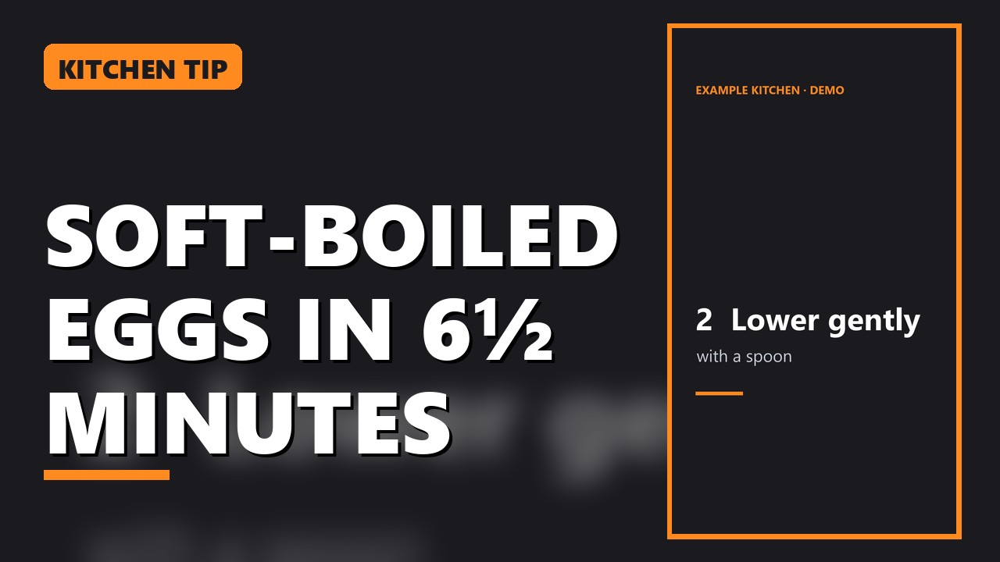
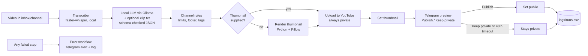
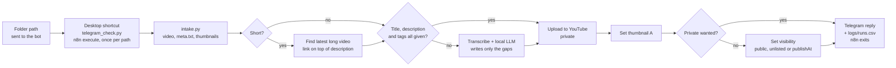

# n8n YouTube publishing workflow

**Drop a video into a folder. The workflow transcribes it, writes the title, description and tags with an LLM, renders a thumbnail and uploads it privately. You approve it on Telegram before it goes public.**

Built with [n8n](https://n8n.io) as the orchestrator. Python only does the two jobs n8n has no node for: local speech-to-text and image rendering.



## What it does

1. **Intake**: a video lands in `inbox/<channel>/`, optionally with a thumbnail (`clip.jpg`) and an instruction file (`clip.txt` or `clip.md`) of the same name. A Local File Trigger waits until the copy is finished.
2. **Transcribe**: [faster-whisper](https://github.com/SYSTRAN/faster-whisper) runs locally on the CPU (no audio leaves the machine). A 35-second Short takes about 40 seconds.
3. **Enrich with a local LLM**: an n8n LLM chain with a local model on [Ollama](https://ollama.com) (default `gemma4`, 8B, on the laptop GPU) writes the title, description, tags, thumbnail text and chapters. Transcript and metadata never leave the machine.
   - If an instruction file exists, its text goes into the prompt, e.g. `Start the title with "Kitchen tip:"`. It overrides the channel style guide but not the rule against invented facts.
   - The output is checked against a JSON schema (Structured Output Parser), not parsed from free text.
4. **Apply channel rules**: a Code node enforces what must never depend on the model:
   - YouTube's limits: title 100 characters, description 5000 bytes, tags 500 characters.
   - The channel's fixed tags, hashtags and footer.
   - Accent-insensitive tag de-duplication.
   - Chapters only for long videos.
5. **Thumbnail**: uses the supplied image, or renders one from a representative frame with the channel's colours and badge.
6. **Upload privately** with the YouTube node, then set the custom thumbnail through the API.
7. **Human in the loop**: Telegram receives the thumbnail, title, description, tags and a YouTube Studio link. It then waits up to 48 hours for **Publish** or **Keep private**.
8. **Release and log**: on Publish, the video is set public, and the workflow reports it if YouTube's audit lock kept it private. Every run appends one line to `logs/runs.csv`. Any failure triggers a separate error workflow, which sends a Telegram alert and logs the failure.



## Second entry point: send a folder path to Telegram

`workflows/yt-publish-telegram.json` uploads from any folder on the PC, with your own texts and thumbnails:

1. **Send the path, then double-click the shortcut**: in Explorer select the folder, press Ctrl+Shift+C (copy as path) and paste it into the chat with the bot. Then double-click **YouTube upload (Telegram)** on the desktop.
   - `scripts/telegram_check.py` fetches the waiting paths from Telegram, which keeps them for 24 hours.
   - It tells the bot it is starting, then runs the workflow once per path with `n8n execute`. n8n exits when the run is done.
   - No n8n server, no tunnel and nothing reachable from the internet in between.
   - Only the chat in `TELEGRAM_CHAT_ID` is accepted. The path reaches the shell only hex-encoded, so a message cannot inject a command.
2. **Check the folder** (`scripts/intake.py`):
   - Finds the video, the optional text file and up to two thumbnails (A = first by file name, B = second).
   - Hard-links them into `work/`, because n8n may only read files inside the repo.
   - Re-saves a thumbnail over YouTube's 2 MB limit as JPEG.
   - Replies with what it found and what is missing.
3. **Linked video**: for a Short, three read-only YouTube API calls find the channel's newest public video longer than 3 minutes, and its link goes at the top of the description. A YouTube link after the path (or `Related:` in the text file) names another video; `no link` skips it. YouTube has no API for the Shorts "Related video" field, so the reply names the video to pick there in Studio.
4. **Fill the gaps**: title, description and tags from the text file are used as written. Only if one of them is missing does the workflow transcribe the video and let the local LLM write the missing fields, using the same preset prompt and channel style guide as the main workflow.
5. **Upload as private**, set thumbnail A, then switch to the wanted visibility or set the publish date, reply with the result and Studio link, log to `logs/runs.csv` (outcome `uploaded_private`, `uploaded_unlisted`, `published`, `scheduled`, `visibility_locked`, `visibility_failed` or `schedule_failed`). The video is always uploaded private first, so it never shows without its thumbnail. The YouTube API accepts one thumbnail per video, so thumbnail B is for A/B testing in YouTube Studio, which YouTube offers for long videos only, not for Shorts.

Text file (`meta.txt`, or the only `.txt`/`.md` in the folder; every part optional, German and Spanish keys work too):

```
Title: Soft-boiled eggs in 6½ minutes
Tags: eggs, breakfast, kitchen tips
Channel: example
Privacy: public
Publish: 18.11.2026 18:00
Related: https://youtu.be/VIDEO_ID
Description:
Everything from here on is the description,
over as many lines as you like.
```

A file without any key is read as the description. The channel comes from `Channel:`, else from a folder named like a channel, else from `DEFAULT_CHANNEL` in `.env`. Sending anything that is not a path returns these instructions.

Visibility is `private` unless you ask for more. Put a word after the path in the message (`"C:\Videos\short 12" public`, also `unlisted`, `öffentlich`, `nicht gelistet`, `público`), or on the next line. Without a word, `Privacy:` in the text file decides, then `DEFAULT_PRIVACY` in `.env`. The message wins over the file. Subscribers are notified only for public videos.

To schedule, write a date and time instead: `"C:\Videos\short 12" 18.11. 18:00`, also `morgen 18 Uhr`, `Freitag 9:30`, `mañana a las 18:00` or `2026-11-18 18:00`, or a `Publish:` line in the text file. The video is uploaded private and YouTube makes it public at that time (`publishAt`). The time is the PC's clock and must be at least 15 minutes ahead; a date without a time, or one in the past, keeps the video private and says why.



## Third entry point: the desktop app

`app/server.py` (desktop shortcut **YouTube upload (Desktop)**) opens a small window with the same workflow and no Telegram:

- **Folder**: choose it or paste the path. **Check** runs `intake.py` at once and shows the video, text file, thumbnails, linked video and visibility.
- **Text with YouTube's limits**: title (100 characters, no `<` `>`), description (5000 bytes), tags (500 characters as YouTube counts them) and a prompt for the LLM (2000 characters). Fields show where their text comes from (text file, AI draft, typed). Empty fields come from the text file or the LLM.
- **Publishing**: channel, linked video (empty means the latest long video), private / unlisted / public, or a publish date.
- **Write missing text with AI** runs the workflow up to the final metadata without uploading (`workflows/yt-publish-desktop-preview.json`) and fills the form with the draft, so you edit it before the upload.
- **Upload** runs `workflows/yt-publish-desktop.json`. The right side shows the workflow's ten steps live, read from n8n's debug log, with seconds per step, then the result with Watch and Studio links.

The server listens on 127.0.0.1 only, accepts API calls only with a token embedded in its own page, and exits when the window closes. n8n runs only while a job runs.

## Design choices

| Choice | Why |
|---|---|
| Nothing irreversible before a human approves | The upload is always private. Only the approval click makes a video public, and a timeout means "keep private". The Telegram entry point makes a video public or unlisted only when the message or the text file asks for it, and only after the thumbnail is set. |
| Local model, optional per-video instructions | No API key, no per-call cost, and transcripts stay on the machine. A plain-text file next to the video steers one video without touching the workflow or the channel config. Ollama runs in JSON mode with thinking off, and the chain retries once on a malformed answer. |
| LLM output is schema-validated, rules are code | The model writes; deterministic code enforces limits, mandatory footer and tags. A bad generation cannot break the upload. |
| Channel settings are data, not workflow logic | Adding a channel means adding `channels/<id>.json` (language, tags, footer, style guide, thumbnail colours) and a folder. No workflow edit. |
| Failures are visible | Error workflow plus Telegram alert. The thumbnail step and the publish step fail softly and say why (unverified channel, API audit lock). |
| Audit trail | One CSV line per run: channel, file, video id, title, outcome (`published`, `publish_locked`, `declined`, `no_answer`, `publish_failed`, `error`; from Telegram or the app also `scheduled`, `uploaded_unlisted`, `uploaded_private`). |
| Least privilege on the host | File nodes are restricted to this folder (`N8N_RESTRICT_FILE_ACCESS_TO`). Secrets live only in n8n's encrypted credential store or `.env`. The approval links are HMAC-signed by n8n. |
| Heavy lifting outside n8n | Transcription and image rendering are small Python scripts that print one JSON object, so n8n stays the single place where the flow is visible. |

The same pattern (intake → AI enrichment → act → human approval → release → log) maps one-to-one onto Microsoft Power Automate; see [docs/power-automate-mapping.md](docs/power-automate-mapping.md).

## What has been tested

On a 35-second dialogue Short with its metadata in another language than the speech, with n8n 2.47.7 on Windows 11, Node 24, Python 3.12:

- **Run from the n8n CLI, ending in the binary ready for upload:** file filter, transcription (language detected, probability 0.999), LLM metadata, channel rules, thumbnail rendering, reading the video.
- **Local model (16 Nov 2026):** gemma4 8B (Q4) on an RTX 5050 laptop GPU wrote the metadata in 25 s. With an instruction file asking for a fixed title prefix and the informal form of address, the title started with that prefix and the description used the informal form. Whole run from file to finished thumbnail: 89 s.
- **Run in Node with mock data:** the preview, approval, log and error-alert code, covering every outcome, Telegram's caption limit and HTML/Markdown escaping.
- **Example output** (the made-up demo channel `example`, a synthetic 24-second Short, desktop app draft):
  - Title: *Soft-boiled eggs: the 6½-minute rule*, from `meta.txt`.
  - Description: the steps with their times from the transcript (rolling boil, six and a half minutes, two minutes in ice water), then the channel's hashtags and footer.
  - 12 tags: the channel's four fixed ones and eight from the LLM. One of them, *egg poaching*, is not in the video, which is why the draft is shown before anything is uploaded.
  - The thumbnail above.

- **Telegram path intake (16 Nov 2026):** tested from the n8n CLI with a fake Telegram message, up to the finished metadata:
  - Folder with title and description but no tags: gemma4 wrote 14 tags in the channel's language, title and description stayed as written. 50 s.
  - Folder with everything (path with spaces, in quotes as Explorer copies it): no transcription, no LLM. 35 s with n8n start-up.
  - Wrong path with `& echo HACKED` appended: error reply, nothing executed.
  - A plain chat message: usage reply.
  - The shortcut path end to end against a fake Telegram API: a leftover webhook was removed, a message from another chat was ignored, the bot got "Starting n8n", n8n ran the workflow once and exited (134 s with cold start, transcription and gemma4). A second check with nothing waiting took 0.8 s.
  - `intake.py` on its own also covers: a free-text file, a Markdown file, no text file, two videos, an unknown channel, four images and a 9 MB PNG thumbnail.

- **Visibility, publish date, linked video (16 Nov 2026):**
  - 52 parser checks on `intake.py`: German, English and Spanish date words, a time alone (today or tomorrow), year rollover, past or too-close dates kept private, links and `no link`, and which source wins.
  - Mock runs of every reply outcome.
  - Real run through n8n with a fake Telegram message `"…\markdown" morgen 18 Uhr`: the three YouTube lookups found the channel's newest long video, its link went on top of the description, and `publishAt` was set to 18:00 on the PC clock. No upload in this test.
- **Desktop app (16 Nov 2026):** "Write missing text with AI" on a folder with title and description but no tags, through the real server and n8n: the steps lit up live (check 3.3 s, linked video 1.4 s, transcription 19.5 s, gemma4 11.4 s; 70 s with n8n start-up). The draft filled 13 tags and the description with the linked video on top, and kept the file's title. The counters block an upload over YouTube's limits (tags 949/500, description 5200/5000 bytes with multi-byte characters, `<` in the title). The **Upload** button itself has not been pressed in a test.

The YouTube and Telegram steps need your own Google OAuth client and Telegram bot (see setup).

## Repository layout

```
channels/        one JSON per YouTube channel; example.json is a made-up demo, your own stay local
scripts/         transcribe.py (faster-whisper), thumbnail.py (Pillow + ffmpeg), intake.py (folder check,
                 visibility, publish date, linked video), telegram_check.py (fetches paths from the bot,
                 runs n8n once per path)
app/             server.py + index.html: the desktop app (live workflow steps, text fields with limits)
workflows/       yt-publish.json (folder drop + approval), yt-publish-telegram.json (folder path via Telegram),
                 yt-publish-desktop.json + yt-publish-desktop-preview.json (desktop app),
                 yt-publish-error.json (error handler), telegram-ping.json (setup check)
setup/           credential-stubs.json (names and ids only, no secrets), create-shortcut.ps1
upload-from-telegram.cmd   what the desktop shortcut runs
docs/            setup.md, power-automate-mapping.md
start-n8n.ps1    starts n8n with the right settings (optional -Tunnel for phone approval)
inbox/<channel>/ drop videos here (+ optional clip.jpg, clip.txt)          logs/runs.csv   run log
```

## Setup

See [docs/setup.md](docs/setup.md): install, import, credentials (Ollama, Telegram, YouTube; Gemini as optional cloud alternative), and the limits Google enforces on new API projects.

## Known limits (set by YouTube, not by the workflow)

- Videos uploaded through an API project that has not passed YouTube's API compliance audit are locked to private. The workflow detects this and links to Studio, where you publish by hand.
- Custom thumbnails need a verified channel.
- The Shorts "Related video" field cannot be set through the API; the workflow puts the link in the description and names the video to pick in Studio.
- The default API quota allows only a handful of uploads per day.
