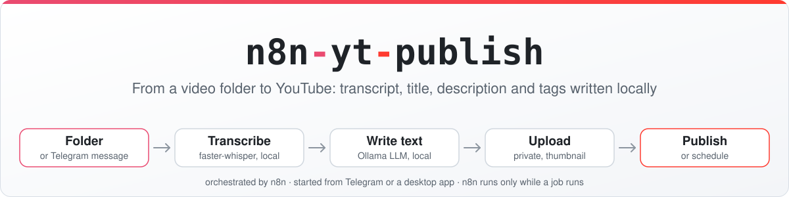
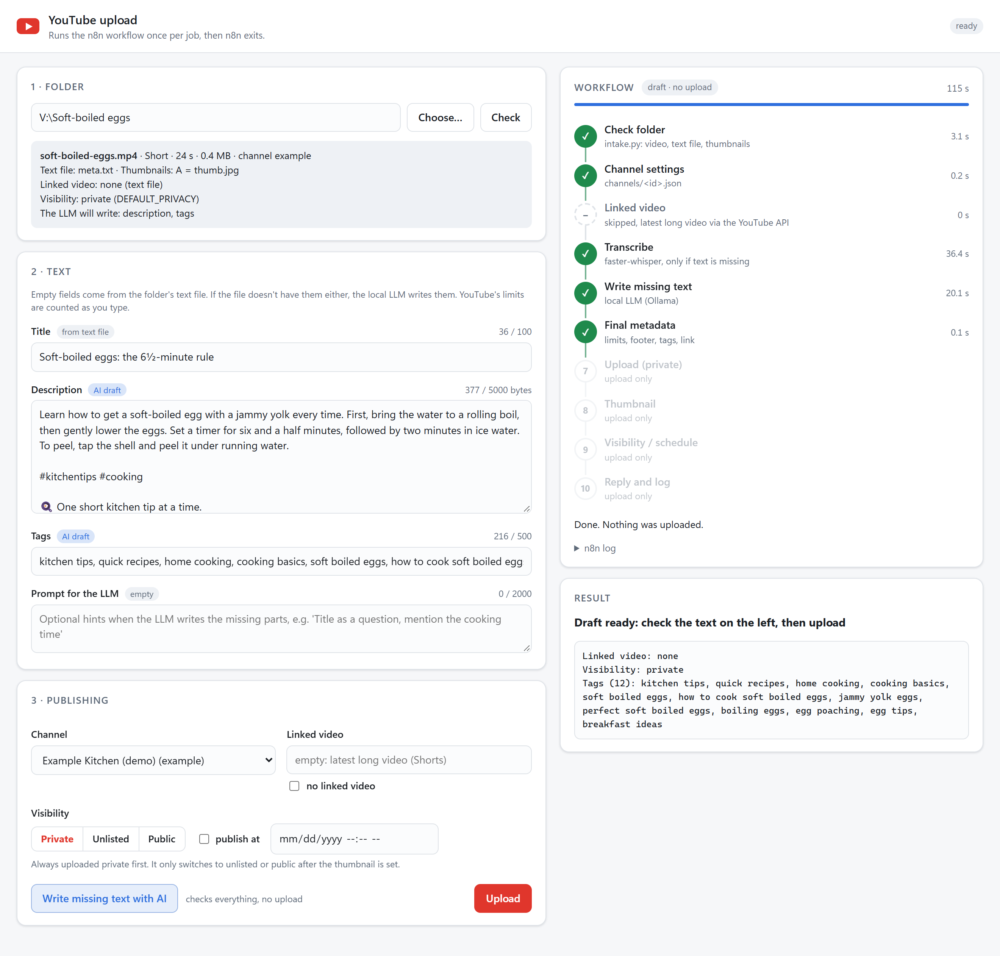
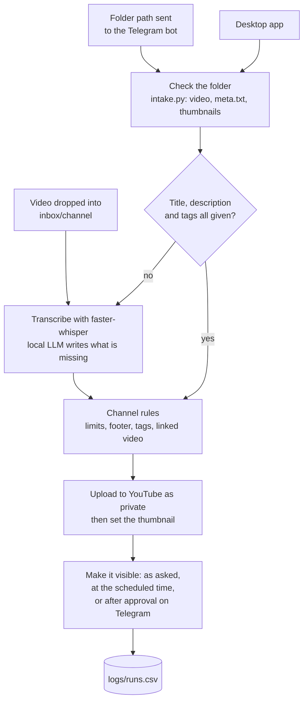

<p align="center">
  <picture>
    <source media="(prefers-color-scheme: dark)" srcset="docs/banner-dark.svg">
    
  </picture>
</p>

<p align="center">
  
  
  
  
  
  
</p>

<p align="center">
  <b>Send a folder path to a Telegram bot, and the video in it ends up on YouTube with a title, description, tags and thumbnail.</b><br>
  n8n runs the workflow; transcription and the LLM run on your own machine, and n8n itself only runs while a job runs.
</p>

<p align="center">
  <a href="#features">Features</a> ·
  <a href="#how-it-works">How it works</a> ·
  <a href="#quick-start">Quick start</a> ·
  <a href="#usage">Usage</a> ·
  <a href="#configuration">Configuration</a> ·
  <a href="docs/how-it-works.md">Full documentation</a>
</p>

<p align="center">
  <picture>
    <source media="(prefers-color-scheme: dark)" srcset="docs/desktop-app-dark.png">
    
  </picture>
  <br>
  <sub>The desktop app after <b>Write missing text with AI</b> on a 24-second Short of a made-up demo channel. The title came from the folder's <code>meta.txt</code>; the local LLM wrote the description and 12 tags from the transcript; <code>Related: none</code> turned the linked video off. 115 s, nothing uploaded.</sub>
</p>

## Features

- **Three ways in**: send a folder path to a Telegram bot, use the desktop app, or drop a file into `inbox/<channel>/` and approve the result on Telegram.
- **Your text first, AI for the gaps**: title, description and tags from a `meta.txt` in the folder are used as written. Only what is missing is written by a local LLM ([Ollama](https://ollama.com), `gemma4` by default), from a transcript by [faster-whisper](https://github.com/SYSTRAN/faster-whisper). The audio, the transcript and the prompts stay on your machine; only the finished video and its texts go to YouTube.
- **Checked output**: the LLM answers in JSON against a schema; code then enforces YouTube's limits (title 100 characters, description 5000 bytes, tags 500 characters), the channel's footer, hashtags and fixed tags.
- **Private first**: every video is uploaded private, gets its thumbnail, and only then turns public, unlisted or scheduled, so it never shows without its thumbnail.
- **Scheduling in plain words**: `18.11. 18:00`, `morgen 18 Uhr`, `Freitag 9:30`, `mañana a las 18:00`.
- **Shorts link back**: the channel's newest long video is linked at the top of every Short's description.
- **Stop from your phone**: `/stop` ends a run and any n8n left running.
- **No server left running**: n8n starts for the job and exits; no tunnel and nothing reachable from the internet for the Telegram and desktop routes.
- **Audit trail**: one line per run in `logs/runs.csv`. Failures are reported in Telegram or in the app, never silently.

## How it works



n8n is the orchestrator: every step is a node you can open in the n8n editor. Python does only what n8n has no node for: reading the folder (`intake.py`), speech-to-text (`transcribe.py`) and rendering a thumbnail when none is supplied (`thumbnail.py`). Each script prints one JSON object back to n8n.

Every step, the design choices and the test log are in **[docs/how-it-works.md](docs/how-it-works.md)**.

## Quick start

You need Windows 10 or 11 for the shortcuts and the desktop app (the workflows themselves run wherever n8n runs), plus:

| Tool | For | Install |
|---|---|---|
| Node.js 24+ and n8n 2.47 | the workflows | `npm install -g n8n` |
| Python 3.10+ | folder check, transcription, thumbnails | `pip install faster-whisper pillow` |
| ffmpeg | video frames and duration | `winget install Gyan.FFmpeg` |
| Ollama and a chat model | title, description, tags | `ollama pull gemma4` |
| Google Cloud project | upload through the YouTube Data API v3 | OAuth client, see [setup](docs/setup.md#youtube-upload-thumbnail-publish) |
| Telegram bot | the message route, alerts, approval | @BotFather, see [setup](docs/setup.md#telegram-preview-approval-alerts) |

```powershell
git clone https://github.com/sguhring/n8n-yt-publish.git
cd n8n-yt-publish
copy .env.example .env          # then fill in TELEGRAM_CHAT_ID, TELEGRAM_BOT_TOKEN, DEFAULT_CHANNEL
n8n import:credentials --input=setup/credential-stubs.json
n8n import:workflow --separate --input=workflows
.\setup\create-shortcut.ps1     # puts "YouTube upload (Telegram)" and "YouTube upload (Desktop)" on the desktop
```

Then open n8n once (`.\start-n8n.ps1`, <http://localhost:5678>) and fill in the Telegram and YouTube credentials. [docs/setup.md](docs/setup.md) walks through each one, including what Google enforces on new API projects.

## Usage

### From Telegram

1. In Explorer, select the folder, press **Ctrl+Shift+C** and paste the path into the chat with your bot. Words after the path change one upload:

   ```text
   "C:\Videos\short 12"                     private, the default
   "C:\Videos\short 12" public              or unlisted
   "C:\Videos\short 12" morgen 18 Uhr       private until then, then public
   "C:\Videos\short 12" no link             no linked video at the top
   ```

2. Double-click **YouTube upload (Telegram)**. For each path the bot says what it found, then sends the result with a YouTube Studio link. Paths wait in Telegram for 24 hours, so you can send them from your phone and run the shortcut later.
3. Send `/stop` to end a run, any n8n still running on the PC, and the paths still waiting. This works while the shortcut's window is open.

### From the desktop app

Double-click **YouTube upload (Desktop)**. Choose the folder and press **Check**, then either type the texts yourself or press **Write missing text with AI** (a draft, nothing is uploaded). **Upload** runs the whole workflow, and the steps light up with their timings as n8n runs them.

### The folder

```text
short 12/
├── video.mp4      the one video in the folder
├── meta.txt       optional, see below
├── thumb_a.jpg    optional: thumbnail A, set through the API
└── thumb_b.jpg    optional: thumbnail B, for A/B tests in YouTube Studio (long videos)
```

```text
Title: Soft-boiled eggs in 6½ minutes
Tags: eggs, breakfast, kitchen tips
Privacy: public
Publish: 18.11.2026 18:00
Related: https://youtu.be/VIDEO_ID
Prompt: Title as a question, mention the cooking time
Description:
Everything from here on is the description,
over as many lines as you like.
```

Every line is optional, and German and Spanish keys work too (`Titel`, `Beschreibung`, `Título`, `Descripción`, …). A file without keys is read as the description.

### Folder drop with approval

Start n8n with `.\start-n8n.ps1 -Tunnel`, activate the workflow "YouTube publish (approve before release)", and drop `clip.mp4` into `inbox/<channel>/`, optionally with `clip.jpg` and `clip.txt`. The workflow transcribes it, writes all the texts, uploads it privately and asks on Telegram: **Publish** or **Keep private**. This route keeps an n8n server and a tunnel running while you use it. See [how it works](docs/how-it-works.md#folder-drop-with-approval-workflowsyt-publishjson).

## Configuration

| You want… | Do this |
|---|---|
| the video public or unlisted at once | `public` or `unlisted` after the path, `Privacy:` in `meta.txt`, or the switch in the app |
| it to go public later | a date and time after the path, `Publish:` in `meta.txt`, or **publish at** in the app (at least 15 minutes ahead, PC clock) |
| another linked video, or none | a YouTube link after the path or in `Related:`; `no link` for none |
| to steer the AI for one video | `Prompt:` in `meta.txt`, the app's **Prompt for the LLM** field, or `clip.txt` next to the video in `inbox/` |
| another default visibility | `DEFAULT_PRIVACY=private`, `unlisted` or `public` in `.env` |
| no linked video by default | `DEFAULT_RELATED=none` |
| another LLM | `OLLAMA_MODEL=` any model from `ollama list` (restart n8n if a server is running) |
| a faster or more exact transcript | `WHISPER_MODEL=tiny`, `base`, `small` (default) or `medium` |
| a second channel | copy `channels/example.json` to `channels/<id>.json` and edit language, tags, footer and style |
| only folders below one path accepted | `INTAKE_ROOT=C:/Users/you/Videos` |
| no 10-minute `/stop` window after a run | `STOP_LISTEN_MINUTES=0` |

All settings with comments: [.env.example](.env.example).

## Project structure

```text
app/              desktop app: server.py (local only, token-protected) + index.html
channels/         one JSON per YouTube channel; example.json is a made-up demo, your own stay local
docs/             setup.md, how-it-works.md, power-automate-mapping.md, images
scripts/          intake.py (folder check, visibility, dates, linked video), transcribe.py,
                  thumbnail.py, telegram_check.py (reads the bot, runs n8n once per path, /stop)
setup/            credential-stubs.json (names and ids only, no secrets), shortcut and task scripts
workflows/        the six n8n workflows: Telegram, desktop upload and draft, folder drop, error handler, ping
start-n8n.ps1     starts n8n with the right settings (-Tunnel for the approval buttons)
upload-from-telegram.cmd   what the Telegram shortcut runs
```

`.env`, `credentials/`, your channel files, `inbox/` media, `work/` and `logs/` stay on your machine; `.gitignore` keeps them out of the repo.

## Known limits

- **Private until audited**: YouTube locks uploads from API projects that have not passed its API compliance audit to private. The workflow says so and links to Studio, where you publish by hand.
- **Thumbnails** need a verified channel.
- **Shorts "Related video"** has no API: the link goes into the description, and the reply names the video to pick in Studio.
- **Quota**: the default YouTube API quota allows only a handful of uploads per day.
- **`/stop` needs the shortcut's window**: nothing listens to the bot while it is closed. A `/stop` sent then acts on the next double-click.

## Built with

[n8n](https://n8n.io) · [faster-whisper](https://github.com/SYSTRAN/faster-whisper) · [Ollama](https://ollama.com) with Gemma · [Pillow](https://python-pillow.org) · [FFmpeg](https://ffmpeg.org) · [YouTube Data API v3](https://developers.google.com/youtube/v3) · [Telegram Bot API](https://core.telegram.org/bots/api)

The same intake → AI → act → approve → log pattern maps onto Microsoft Power Automate: [docs/power-automate-mapping.md](docs/power-automate-mapping.md).

## License

No license chosen yet, so all rights are reserved. Please ask before reusing the code.
